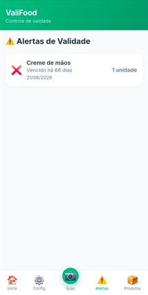

# 🥗 ValiFood — Controle de Despensa e Validade

Aplicação web para organização de produtos domésticos, controle de quantidades e acompanhamento de datas de validade, desenvolvida com Python e Flask.

O sistema permite cadastrar produtos por categoria, consultar itens próximos do vencimento e utilizar a câmera do celular para identificar códigos de barras e facilitar o cadastro ou a baixa de produtos.

## Contexto e objetivo

Desenvolvi o ValiFood para ajudar minha esposa a organizar os produtos da despensa.

Em algumas ocasiões, ao buscar um produto para utilizar, ela percebia que ele já estava vencido. O sistema surgiu para facilitar o acompanhamento dos itens disponíveis e de suas datas de validade.

Com o ValiFood, é possível consultar os produtos cadastrados, acompanhar quantidades e identificar quais precisam de atenção antes do vencimento, apoiando o planejamento do consumo e a redução de desperdícios.

## Situação do projeto

**Em uso e em evolução.**

A aplicação é utilizada na organização doméstica e recebe melhorias conforme as necessidades identificadas no dia a dia.

## Principais funcionalidades

- Cadastro e login de usuários.
- Cadastro de produtos com nome, marca e código de barras.
- Organização de produtos por categoria.
- Registro do local de armazenamento.
- Controle de quantidade e unidade de medida.
- Registro da data de validade.
- Opção de cadastro de produtos sem validade.
- Leitura de código de barras pela câmera do celular.
- Identificação de produtos já cadastrados.
- Baixa de produtos e redução de quantidades.
- Busca de produtos.
- Filtros para acompanhamento de vencimentos.
- Tela de alertas de validade.
- Configuração de preferências de antecedência dos alertas.
- Histórico de movimentações.
- Interface responsiva com navegação pelo celular.

## 📸 Demonstração do sistema

### Tela inicial

Página inicial com acesso às categorias e histórico recente de cadastros, alterações e remoções.


### Leitura de código de barras

O botão Scan abre a câmera para identificar o código de barras de um produto e iniciar o fluxo de cadastro ou movimentação.


### Cadastro de produtos

Formulário com nome, código de barras, marca, categoria, local de armazenamento, quantidade, unidade e data de validade.


### Acompanhamento dos produtos

Listagem com busca, filtros de vencimento e informações sobre quantidade, marca, local e situação da validade.


### Alertas de validade

Tela para identificar produtos vencidos e próximos do vencimento, com indicação da data e da quantidade disponível.



### Configurações

Tela com informações do perfil e opções para definir as preferências de antecedência dos alertas.


## Fluxo de utilização

1. Criar uma conta e entrar no sistema.
2. Clicar no botão Scan e permitir o acesso à câmera.
3. Apontar a câmera para o código de barras do produto.
4. Se o produto ainda não estiver cadastrado, iniciar o cadastro e preencher suas informações.
5. Se o produto já estiver cadastrado, utilizar as opções de movimentação para dar baixa ou reduzir a quantidade.
6. Consultar os produtos por categoria e acompanhar as datas de validade.
7. Verificar os alertas para planejar o consumo dos itens.

## Cadastro e movimentação por código de barras

A leitura do código de barras facilita a identificação dos produtos e reduz a necessidade de procurá-los manualmente.

| Situação | Funcionamento |
|---|---|
| Produto não cadastrado | O sistema oferece a opção de iniciar o cadastro. |
| Produto já cadastrado | O sistema permite acessar as opções de movimentação. |
| Consumo de parte do estoque | A quantidade pode ser reduzida conforme o consumo. |
| Baixa do produto | O usuário registra a retirada do item do estoque. |

O código de barras identifica o produto. A data de validade deve ser informada no cadastro; ela não é obtida automaticamente pelo código de barras comum.

## Organização dos produtos

Os produtos são organizados por categoria para facilitar a consulta da despensa.

O cadastro reúne:

- Nome do produto.
- Marca.
- Código de barras.
- Categoria.
- Local de armazenamento.
- Quantidade.
- Unidade de medida.
- Data de validade ou indicação de produto sem validade.
- Observações.

## Acompanhamento de validade

O sistema apresenta a situação dos produtos com base nas datas cadastradas.

| Situação | Finalidade |
|---|---|
| Vencido | Identificar produtos cuja data de validade já passou. |
| Vence hoje | Destacar os produtos com vencimento no dia atual. |
| Próximo do vencimento | Facilitar o planejamento do consumo. |
| Sem validade cadastrada | Permitir o controle de itens que não utilizam uma data de vencimento. |

A tela de configurações permite salvar preferências para o dia do vencimento e para antecedências de 1, 3, 7, 14 e 30 dias.

Os alertas de validade são apresentados na aplicação.

## Tecnologias

| Camada | Tecnologias |
|---|---|
| Backend | Python e Flask |
| Persistência | SQLAlchemy e Flask-SQLAlchemy |
| Banco de dados padrão | SQLite |
| Autenticação | Flask-Login |
| Interface | HTML, CSS e JavaScript |
| Leitura de códigos | Câmera do dispositivo integrada à interface web |
| Datas e fuso horário | datetime e pytz |
| Versionamento | Git e GitHub |

## Organização do código

O backend utiliza uma fábrica de aplicação e módulos separados por responsabilidade.

```text
run.py
requirements.txt
config.py

app/
├── __init__.py
├── models.py
├── auth.py
├── products.py
├── categories.py
├── dashboard.py
├── notifications.py
├── api.py
├── templates/
└── static/
    ├── css/
    ├── js/
    ├── icons/
    ├── manifest.json
    └── service-worker.js
```

- **run.py:** ponto de entrada para execução local.
- **app/__init__.py:** criação da aplicação e registro dos módulos.
- **models.py:** modelos de dados.
- **auth.py:** autenticação de usuários.
- **products.py:** cadastro e gerenciamento de produtos.
- **categories.py:** organização das categorias.
- **dashboard.py:** página inicial.
- **notifications.py:** alertas de validade e preferências.
- **api.py:** endpoints utilizados pela aplicação.
- **templates:** páginas da interface.
- **static:** estilos, scripts e recursos visuais.

## Aspectos técnicos do projeto

- Organização do backend com Blueprints do Flask.
- Criação da aplicação por meio de uma função create_app.
- Persistência de usuários, produtos, categorias e movimentações.
- Consulta de produtos vinculados ao usuário autenticado.
- Integração da câmera ao fluxo de identificação de produtos.
- Controle de estoque por quantidade.
- Cálculo da proximidade do vencimento a partir das datas cadastradas.
- Interface voltada ao uso pelo celular.
- Histórico para acompanhamento das alterações realizadas.

## Execução local

### 1. Clonar o repositório

```bash
git clone https://github.com/LovanGoulart/valifood.git
cd valifood
```

### 2. Criar um ambiente virtual

```bash
python -m venv .venv
```

### 3. Ativar o ambiente virtual

**Windows — Git Bash:**

```bash
source .venv/Scripts/activate
```

**Windows — Prompt de Comando:**

```bat
.venv\Scripts\activate.bat
```

**Linux ou macOS:**

```bash
source .venv/bin/activate
```

### 4. Instalar as dependências

```bash
python -m pip install -r requirements.txt
```

### 5. Iniciar a aplicação

```bash
python run.py
```

### 6. Acessar no navegador

```text
http://localhost:8000
```

Na configuração padrão, a aplicação utiliza SQLite e inicializa as tabelas durante a criação do aplicativo.

### Acesso à câmera

O navegador precisa de permissão para utilizar a câmera.

Para acessar pelo celular em uma hospedagem, utilize HTTPS. O acesso por HTTP a um endereço IP da rede local pode impedir o funcionamento da câmera.

### Configuração para publicação

A aplicação permite configurar as variáveis de ambiente:

- **SECRET_KEY:** chave utilizada para proteger as sessões.
- **DATABASE_URL:** endereço de conexão com o banco de dados.

O servidor iniciado por `python run.py` é destinado ao desenvolvimento. A publicação exige configuração própria de hospedagem.

## Autor

Desenvolvido por **Lovan Goulart** para ajudar na organização da despensa doméstica e no acompanhamento da validade dos produtos.

[Perfil no GitHub](https://github.com/LovanGoulart)
